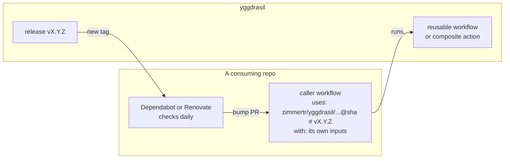
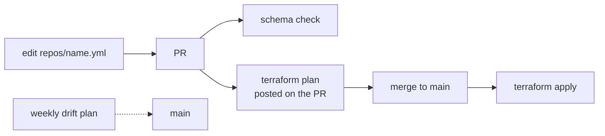

# Architecture

yggdrasil has two halves that share one repo, one version and one bot identity:

- **Modules**: reusable workflows and composite actions. A repo calls one with a pinned `uses:` and its own inputs, instead of copying a pipeline.
- **Infrastructure**: Terraform that creates and manages TJ's repos and orgs on GitHub, Docker Hub and Cloudflare.

The full design is in [PRD.md](PRD.md). This page says what each part is, where it lives, and which issue builds it. Each part below is built by the issue it names.

## Layout

| Path | Holds | Built in |
|---|---|---|
| `.github/workflows/` | yggdrasil's own CI, and the reusable workflows (GitHub requires both here) | #2, #4 |
| `actions/<name>/` | Composite actions, each with its script and tests | #2, #4 |
| `defaults/` | The shared conventions: `GitVersion.yml`, `trivy.yaml` | #4 |
| `profiles/<name>.yml` | The settings each profile sets: `default` and `archived` | #8 |
| `repos/<name>.yml` | One file per managed repo | #8 |
| `orgs/<name>.yml` | One file per managed org | #8 |
| `schemas/` | JSON Schemas for `repos/`, `orgs/` and `profiles/` | #8 |
| `terraform/github/` | The stack that reads `repos/` and `orgs/` | #8 |
| `terraform/dockerhub/` | Docker Hub repositories and their immutable tags | #9 |
| `terraform/cloudflare/` | The stack moved from Kubernetes-Manifests, with its state | #10 |
| `scripts/` | Scripts yggdrasil's own CI runs, such as the policy check | #2 |
| `tests/` | The test suite for `scripts/` | #2 |
| `Makefile`, `compose.yml` | Every check as a `make` target, and the pinned images each one runs in | #2 |
| `docs/` | These pages and the decision records | #2 |

## How a repo uses a module

- The caller passes everything repo-specific as inputs. yggdrasil keeps no per-repo pipeline config. Record: [0002](architectural-decision-records/0002-callers-bring-their-own-config.md)
- Every module shares one SemVer. A merge that changes a module path releases; a settings-only merge releases nothing. Record: [0004](architectural-decision-records/0004-one-version-for-every-module.md)
- Each consumer takes a release the day it ships. Patch and minor bumps merge themselves; a major waits for TJ. Record: [0005](architectural-decision-records/0005-every-repo-is-production.md)

A job inside a reusable workflow reports its check as `caller / callee`, so a consumer that switches to a module renames its required checks in the same step (#5 to #7). A `./` path inside a reusable workflow resolves in the caller's checkout, not in yggdrasil's, so a module that needs its own files fetches them at its pinned ref (#3 tests this).

## How a setting changes

Until #8 imports them, settings are API calls TJ okays first, logged in [CICD.md](CICD.md#settings-applied-by-api). Record: [0014](architectural-decision-records/0014-foundation-by-hand-then-imported.md)

## The bot

Every write that automation makes, in yggdrasil and later in the consumers, uses a token minted per run from the GitHub App `zimmertr-yggdrasil-bot`. Its permissions and installations are in [CONFIGURATION.md](CONFIGURATION.md#the-app). Record: [0007](architectural-decision-records/0007-one-bot-identity.md)

## What is managed

Five orgs (Bluebird-Forecast, Fellfield-Game, GPX-Search, TJs-Kubernetes-Service, Lakebagger) and twenty repos, listed in [PRD.md](PRD.md#4-core-components). Each repo is both managed by Terraform and a consumer of the modules. Record: [0012](architectural-decision-records/0012-one-file-per-repo-and-org.md)
