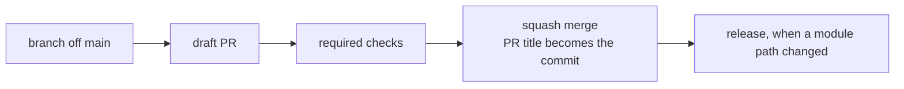

# CI/CD

How a change gets from a PR to main, and later to every consuming repo. #2 adds the checks one PR at a time, and this page grows with each.

## From PR to main

- Every change reaches main through a PR. The repo allows squash merges only, with the PR title as the commit title and the PR body as the message.
- The PR title is `type(scope): summary`, with a type from `GitVersion.yml`: `feat` releases a minor, a `!` before the colon a major (a change that breaks a caller), and every other type a patch. The `PR Title` job refuses any other title. Records: [0004](architectural-decision-records/0004-one-version-for-every-module.md), [0020](architectural-decision-records/0020-pr-titles-checked-by-a-community-action.md)
- `ci-release.yml` releases yggdrasil through its own release module. On a PR it runs in dry run, and the `Release / Version` job says what the merge will release, or that it releases nothing. On main it tags the merge commit `vX.Y.Z` and publishes an immutable GitHub release with notes from the merged PR titles. A merge that touches no module path gives back a version already tagged, and releases nothing. Record: [0027](architectural-decision-records/0027-release-module.md)
- `terraform-github.yml` applies the github stack when a merge touches `terraform/`, `repos/` or `orgs/`. Its `Apply github` job plans again on main with write tokens, and applies only when that plan matches the merged PR's plan comment; otherwise it fails and changes nothing. Applies run one at a time and are never cancelled. Record: [0045](architectural-decision-records/0045-merges-apply-through-dflook.md) An import's apply always refuses, because the imported repo's `etag` differs between the two plans. TJ then starts `terraform-github` by hand from the Actions tab, on main, and it applies main's plan without the comment check. Record: [0048](architectural-decision-records/0048-imports-apply-by-hand.md)
- `terraform-cloudflare.yml` does the same for the cloudflare stack when a merge touches `terraform/cloudflare/`, in its `Apply cloudflare` job, with the `CLOUDFLARE_API_TOKEN` secret. Started by hand from main, it applies main's plan as it is.

## PR checks

Every job runs in the same pinned container a local `make` run uses. Record: [0018](architectural-decision-records/0018-checks-run-through-make-in-pinned-containers.md)

| Workflow | Job | Runs | Fails on |
|---|---|---|---|
| `checks.yml` | `Lint / actionlint` | The lint module on this repo, from this PR's copy: actionlint, with shellcheck on every `run:`. Record: [0037](architectural-decision-records/0037-lint-module.md) | Any finding in `.github/workflows/` |
| `checks.yml` | `Lint / zizmor` | The lint module: zizmor's pedantic audits, online with the job's read-only token, findings as PR annotations | Any finding: an unpinned action or a version comment that is missing or wrong, `${{ }}` inside `run:`, a checkout that keeps credentials, `pull_request_target`, broad permissions and the rest |
| `checks.yml` | `Lint / semgrep` | The lint module: Semgrep's registry rule `dockerfile-source-not-pinned` | A Dockerfile `FROM` with a tag but no `@sha256:` digest, outside test folders |
| `checks.yml` | `Terraform / fmt` | The terraform module on this repo, from this PR's copy: `terraform fmt -recursive -check`. Record: [0042](architectural-decision-records/0042-terraform-module.md) | A file `terraform fmt` would change |
| `checks.yml` | `Terraform / validate` | The terraform module: `terraform validate` in each folder `checks.yml` lists | Invalid Terraform |
| `checks.yml` | `Terraform / test` | The terraform module: `terraform test` with mock providers, in each listed folder | A failing test |
| `checks.yml` | `Terraform / tflint` | The terraform module: tflint's bundled recommended rules | Any finding, such as an unused variable |
| `checks.yml` | `Terraform / trivy` | The terraform module: Trivy's misconfiguration scan of each listed folder, with `defaults/trivy.yaml` | Any finding |
| `pr-title.yml` | `PR Title` | `amannn/action-semantic-pull-request` on the title, on every edit and push | A title that isn't `type(scope): summary` with a type from `GitVersion.yml`'s patterns. Record: [0020](architectural-decision-records/0020-pr-titles-checked-by-a-community-action.md) |
| `checks.yml` | `Docs` | `make docs`: lychee over every relative link and heading anchor, and a grep for em dashes | A broken link or anchor, or an em dash |
| `ci-docker-build.yml` | `Docker Build Test / Docker Build` | The docker-build module on `tests/docker-build/`. Only on PRs that touch the module, its test or `defaults/trivy.yaml`, so it isn't required | Any failure of the module |
| `terraform-github.yml` | `Plan github` | `dflook/terraform-plan` on the github stack, with write tokens from `zimmertr-yggdrasil-bot`, one per owner, the same as the apply's: a read-only token can't see a repo's merge settings. Posts the plan as one PR comment that each run updates. Only on PRs from this repo's own branches, Dependabot's included, that touch `terraform/`, `repos/` or `orgs/`, so it isn't required. Records: [0044](architectural-decision-records/0044-pr-plans-run-through-dflook-with-read-only-tokens.md), [0047](architectural-decision-records/0047-pr-plans-use-the-applys-write-tokens.md) | A plan that errors, such as a precondition refusing an unknown key. A plan with changes passes: TJ reads it before merging |
| `terraform-cloudflare.yml` | `Plan cloudflare` | `dflook/terraform-plan` on the cloudflare stack, with `CLOUDFLARE_API_TOKEN`, as one PR comment that each run updates. Only on PRs from this repo's own branches, Dependabot's included, that touch `terraform/cloudflare/`, so it isn't required | A plan that errors. A plan with changes passes: TJ reads it before merging |
| `ci-release.yml` | `Release / Version` | The release module in dry run: GitVersion on the squash commit this PR will make | GitVersion failing or giving something other than `X.Y.Z` |
| `ci-release.yml` | `Release / Build & Push (zimmertr/yggdrasil-test)` | The same dry run building `tests/docker-build/` for `linux/amd64` and `linux/arm64`, pushing nothing | A build that fails |

Branch protection requires `Lint / actionlint`, `Lint / zizmor`, `Lint / semgrep`, the five `Terraform /` checks, `Docs` and `PR Title` (logged below). A check joins it only after it has reported once, because a required check that never reports blocks every PR. Renaming one of these jobs means updating protection in the same PR. CodeQL's default setup scans the workflows too.

## Dependabot

`.github/dependabot.yml` updates the pinned actions (`github-actions`), the providers in each stack's `.terraform.lock.hcl` (`terraform`, every directory under `terraform/`) and the tool images in `compose.yml` (`docker-compose`) weekly, each version waiting seven days after its release. Security updates skip the wait. Titles are `build(deps): ...`, a patch.

`dependabot-auto-merge.yml` arms squash auto-merge on Dependabot's patch and minor updates, with a token minted from `zimmertr-yggdrasil-bot`, and comments on the PR as the bot. Majors, digest-only updates and every Terraform provider update wait for TJ: once a merge applies a stack (#8), a provider bump changes what the next apply does. Record: [0042](architectural-decision-records/0042-terraform-module.md) Record: [0021](architectural-decision-records/0021-dependabot-with-app-auto-merge.md)

## Secrets

| Secret | Kind | Holds | Used by |
|---|---|---|---|
| `YGGDRASIL_BOT_PRIVATE_KEY` | Dependabot | The App's private key, set by TJ | `dependabot-auto-merge.yml`, and `terraform-github.yml` on Dependabot's PRs |
| `TF_API_TOKEN` | Dependabot | The same HCP Terraform team token, set by TJ on 2026-11-07 | `terraform-github.yml` and `terraform-cloudflare.yml` on Dependabot's PRs, so a provider bump shows its plan |
| `YGGDRASIL_BOT_PRIVATE_KEY` | Actions | The same key, set by TJ on 2026-11-06 | `terraform-github.yml`, for the plan and the apply |
| `TF_API_TOKEN` | Actions | The HCP Terraform team token for `Yggdrasil-Org`, set by TJ on 2026-11-06 | `terraform-github.yml` and `terraform-cloudflare.yml`, for the plan and the apply |
| `CLOUDFLARE_API_TOKEN` | Actions and Dependabot | A Cloudflare API token with Tunnel Edit, Account API Tokens Edit, Zone Read and DNS Edit, the same one as in TJ's `~/.claude/secrets.json`, set on 2026-11-10 with TJ's okay (#10) | `terraform-cloudflare.yml`, for the plan and the apply |

The key and the HCP token are each stored twice because a run Dependabot starts can't read Actions secrets, and other runs can't read Dependabot's. There are no GitHub environments: plan and apply hold the same key, so an environment that locks apply to main would guard nothing the plan doesn't already hold (TJ, 2026-11-06, #8). The plan uses the same write tokens as the apply, since a read-only token can't see a repo's merge settings. Record: [0047](architectural-decision-records/0047-pr-plans-use-the-applys-write-tokens.md) The workflow names the App by its public client ID, so `YGGDRASIL_BOT_APP_ID`, which held the App ID, was deleted on 2026-11-05 with TJ's okay. yggdrasil has no `AUTO_MERGE_PAT`: its auto-merge mints an App token instead. Record: [0007](architectural-decision-records/0007-one-bot-identity.md)

Never print, log or paste a secret's value. #12 inventories every secret across TJ's repos and services.
