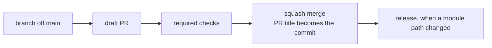

# CI/CD

How a change gets from a PR to main, and later to every consuming repo. As of 2026-11-05 no workflow exists yet: #2 adds the checks one PR at a time, and this page grows with each.

## From PR to main

- Every change reaches main through a PR. The repo allows squash merges only, with the PR title as the commit title and the PR body as the message.
- The PR title is `type(scope): summary`. It picks the next version, and a `!` before the colon marks a change that breaks a caller. Record: [0004](architectural-decision-records/0004-one-version-for-every-module.md)
- The required checks and branch protection arrive with #2 items 0.4 to 0.9. A check is added to protection only after it has reported once, because a required check that never reports blocks every PR.
- The release workflow arrives with the modules in #4.

## Settings applied by API

Until #8 imports the repo into Terraform, its settings are API calls that TJ okays first. Each one is logged here, so #8 can check its import against this list. Record: [0014](architectural-decision-records/0014-foundation-by-hand-then-imported.md)

### 2026-11-05, #2 item 0.1

Before: merge commits and rebase merges allowed, the squash commit built from the commit messages, auto-merge off, head branches kept, the update-branch button off, wiki and projects on, Dependabot alerts and security updates off, private vulnerability reporting off, immutable releases off, and `sha_pinning_required` false. Secret scanning and push protection were already on.

| Call | Sets |
|---|---|
| `gh api -X PATCH repos/zimmertr/yggdrasil -F allow_squash_merge=true -F allow_merge_commit=false -F allow_rebase_merge=false -f squash_merge_commit_title=PR_TITLE -f squash_merge_commit_message=PR_BODY -F allow_auto_merge=true -F delete_branch_on_merge=true -F allow_update_branch=true -F has_wiki=false -F has_projects=false` | Squash only, with the PR title and body; auto-merge; head branches deleted; update-branch button; wiki and projects off |
| `gh api -X PUT repos/zimmertr/yggdrasil/vulnerability-alerts` | Dependabot alerts |
| `gh api -X PUT repos/zimmertr/yggdrasil/automated-security-fixes` | Dependabot security updates |
| `gh api -X PUT repos/zimmertr/yggdrasil/private-vulnerability-reporting` | Private vulnerability reporting |
| `gh api -X PUT repos/zimmertr/yggdrasil/immutable-releases` | Immutable releases |
| `gh api -X PUT repos/zimmertr/yggdrasil/actions/permissions -F enabled=true -f allowed_actions=all -F sha_pinning_required=true` | Actions must be pinned to a full commit SHA |

Each setting was read back from its endpoint after the call.

## Secrets

| Secret | Kind | Holds | Used by |
|---|---|---|---|
| `YGGDRASIL_BOT_APP_ID` | Dependabot | The App ID of `zimmertr-yggdrasil-bot` | `dependabot-auto-merge.yml` (#2 item 0.8) |
| `YGGDRASIL_BOT_PRIVATE_KEY` | Dependabot | The App's private key, set by TJ | `dependabot-auto-merge.yml` (#2 item 0.8) |

They are Dependabot secrets because a run Dependabot starts can't read Actions secrets. yggdrasil has no `AUTO_MERGE_PAT`: its auto-merge mints an App token instead. Record: [0007](architectural-decision-records/0007-one-bot-identity.md)

Never print, log or paste a secret's value. #12 inventories every secret across TJ's repos and services.
