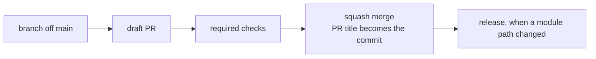

# CI/CD

How a change gets from a PR to main, and later to every consuming repo. #2 adds the checks one PR at a time, and this page grows with each.

## From PR to main

- Every change reaches main through a PR. The repo allows squash merges only, with the PR title as the commit title and the PR body as the message.
- The PR title is `type(scope): summary`, with a type from `GitVersion.yml`: `feat` releases a minor, a `!` before the colon a major (a change that breaks a caller), and every other type a patch. The `PR Title` job refuses any other title. Records: [0004](architectural-decision-records/0004-one-version-for-every-module.md), [0020](architectural-decision-records/0020-pr-titles-checked-by-a-community-action.md)
- The release workflow arrives with the modules in #4.

## PR checks

Every job runs a `make` target, in the same pinned container a local run uses. Record: [0018](architectural-decision-records/0018-checks-run-through-make-in-pinned-containers.md)

| Workflow | Job | Runs | Fails on |
|---|---|---|---|
| `checks.yml` | `actionlint` | `make actionlint`: actionlint, with shellcheck on every `run:`. Then `make shellcheck` over every shell script outside the workflows | Any finding in `.github/workflows/` or in a script listed in the `Makefile`'s `SHELL_SCRIPTS` |
| `checks.yml` | `zizmor` | `make zizmor`: zizmor's pedantic audits, online with the job's read-only token, findings as PR annotations | Any finding: an unpinned action or a version comment that is missing or wrong, `${{ }}` inside `run:`, a checkout that keeps credentials, `pull_request_target`, broad permissions and the rest |
| `pr-title.yml` | `PR Title` | `amannn/action-semantic-pull-request` on the title, on every edit and push | A title that isn't `type(scope): summary` with a type from `GitVersion.yml`'s patterns. Record: [0020](architectural-decision-records/0020-pr-titles-checked-by-a-community-action.md) |
| `checks.yml` | `Docs` | `make docs`: lychee over every relative link and heading anchor, and a grep for em dashes | A broken link or anchor, or an em dash |
| `checks.yml` | `GitVersion Engine` | `make gitversion`: GitVersion, in its pinned image, on made-up histories under `GitVersion.yml` and `defaults/GitVersion.yml` | A version or `Sha` that differs from what record 0004 says: a settings-only commit that releases, a body line that picks the bump, a caller's merge that doesn't release. Record: [0025](architectural-decision-records/0025-gitversion-tested-in-its-own-image.md) |

`checks.yml` also has `workflow_call`, so the release workflow (#4) can run the checks on the merged commit before it builds anything. Record: [0019](architectural-decision-records/0019-community-tools-hold-workflows-and-docs.md)

Branch protection requires `actionlint`, `zizmor`, `Docs` and `PR Title` (logged below). A check joins it only after it has reported once, because a required check that never reports blocks every PR. Renaming one of these jobs means updating protection in the same PR. CodeQL's default setup scans the workflows too.

## Settings applied by API

Until #8 imports the repo into Terraform, its settings are API calls that TJ okays first. Each one is logged here, so #8 can check its import against this list. Record: [0014](architectural-decision-records/0014-foundation-by-hand-then-imported.md)

### 2026-11-05, #2 item 0.1

Before: merge commits and rebase merges allowed, the squash commit built from the commit messages, auto-merge off, head branches kept, the update-branch button off, wiki and projects on, Dependabot alerts and security updates off, private vulnerability reporting off, immutable releases off, and `sha_pinning_required` false. Secret scanning and push protection were already on.

| Call | Sets |
|---|---|
| `gh api -X PATCH repos/zimmertr/yggdrasil -F allow_squash_merge=true -F allow_merge_commit=false -F allow_rebase_merge=false -f squash_merge_commit_title=PR_TITLE -f squash_merge_commit_message=PR_BODY -F allow_auto_merge=true -F delete_branch_on_merge=true -F allow_update_branch=true -F has_wiki=false -F has_projects=false` | Squash only, with the PR title and body; auto-merge; head branches deleted; update-branch button; wiki and projects off |
| `gh api -X PUT repos/zimmertr/yggdrasil/vulnerability-alerts` | Dependabot alerts |
| `gh api -X PUT repos/zimmertr/yggdrasil/automated-security-fixes` | Dependabot security updates |
| `gh api -X PUT repos/zimmertr/yggdrasil/private-vulnerability-reporting` | Private vulnerability reporting |
| `gh api -X PUT repos/zimmertr/yggdrasil/immutable-releases` | Immutable releases |
| `gh api -X PUT repos/zimmertr/yggdrasil/actions/permissions -F enabled=true -f allowed_actions=all -F sha_pinning_required=true` | Actions must be pinned to a full commit SHA |

Each setting was read back from its endpoint after the call.

### 2026-11-05, #2 item 0.9

TJ okayed both. Before: no branch protection and no code scanning.

| Call | Sets |
|---|---|
| `gh api -X PUT repos/zimmertr/yggdrasil/branches/main/protection --input protection.json` | Required checks `actionlint`, `zizmor`, `Docs` and `PR Title` from GitHub Actions (app 15368), not strict; a PR for every change with 0 approvals and stale reviews dismissed; admins included; conversations resolved; no force-push, no deletion |
| `gh api -X PATCH repos/zimmertr/yggdrasil/code-scanning/default-setup -f state=configured -f query_suite=default -f 'languages[]=actions'` | CodeQL default setup for the workflows |

`protection.json` held exactly those fields; the read-back of `branches/main/protection` matched it.

## Dependabot

`.github/dependabot.yml` updates the pinned actions (`github-actions`) and the tool images in `compose.yml` (`docker-compose`) weekly, each version waiting seven days after its release. Security updates skip the wait. Titles are `build(deps): ...`, a patch.

`dependabot-auto-merge.yml` arms squash auto-merge on Dependabot's patch and minor updates, with a token minted from `zimmertr-yggdrasil-bot`, and comments on the PR as the bot. Majors and digest-only updates wait for TJ. Record: [0021](architectural-decision-records/0021-dependabot-with-app-auto-merge.md)

## Secrets

| Secret | Kind | Holds | Used by |
|---|---|---|---|
| `YGGDRASIL_BOT_PRIVATE_KEY` | Dependabot | The App's private key, set by TJ | `dependabot-auto-merge.yml` |

It is a Dependabot secret because a run Dependabot starts can't read Actions secrets. The workflow names the App by its public client ID, so `YGGDRASIL_BOT_APP_ID`, which held the App ID, was deleted on 2026-11-05 with TJ's okay. yggdrasil has no `AUTO_MERGE_PAT`: its auto-merge mints an App token instead. Record: [0007](architectural-decision-records/0007-one-bot-identity.md)

Never print, log or paste a secret's value. #12 inventories every secret across TJ's repos and services.
